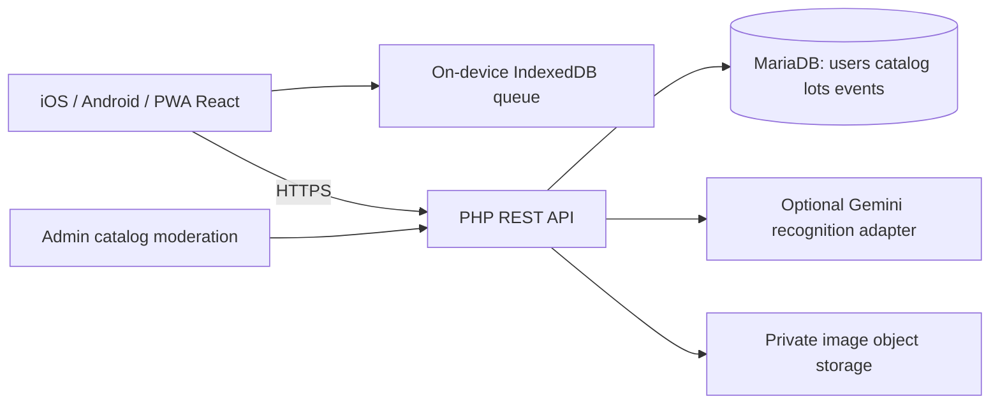

# Cigario architecture & trust boundaries

## Current foundation
The repository contains a public website at `/`, a responsive web app at `/app/`, Capacitor mobile source, and a PHP/MariaDB API at `/api/v1/`. `src/cloud.ts` supports same-origin browser sessions and account inventory once a real backend is deployed and configured. This is an **unhosted implementation foundation**, not a live synchronized product. Local demo entries remain fictional and stored in localStorage when disconnected; the scanner does not identify cigar bands. Native credential-safe sync is not yet implemented.

## Shared infrastructure
The web browser and future native clients use HTTPS to access one server API; MariaDB is never exposed to clients. The hosting document root contains static compiled assets and the PHP API endpoint; credentials remain outside that root. The SQL migration contains users, catalog provenance, lots, stock events, review and auth tables. Default registration is disabled, and no fake catalog data is migrated.

## Intended production

No always-running worker on shared hosting. AI processing must be bounded, metered and hosted separately if necessary. API keys must never ship in mobile binaries. Users confirm every recognized candidate and vitola.

## Future server schema (high level)
- `users`, `sessions`, `consents`
- `brands`, `cigar_lines`, `cigar_variants`, `catalog_fields`, `field_sources`, `band_references`
- `humidors`, `locations`, `acquisition_lots`, `stock_events`, `reviews`
- `scan_jobs`, `scan_candidates`, `catalog_change_requests`, `audit_events`

Use UUID/ULID IDs. Add unique client mutation keys to stock-events for offline replay protection; transactionally enforce non-negative stock. MSRP is an estimate of current stock, not a certified appraisal or purchase valuation. Source/version/review fields exist for each catalog claim. Images require permissions, type validation, size limits, malware review and retention settings.

## Security gates
Authenticated row-level ownership checks for all private inventory writes/reads, admin RBAC, rate limits, anti-CSRF as applicable, consent-gated image transfer, secret management, export/deletion, signed migrations, backup restore drills, HTTPS and secure cookie/token strategy. No user-controlled URL fetching or blind scraping. Test multi-user isolation.

## RawGraded reuse policy
Reuse concepts from capture UX, acquisition wizard, ownership checks, event lineage, provider adapters and image preprocessing; do not copy grading thresholds, card-specific image crops, marketplace modules, private keys or production schema. Verify source licenses and provenance before borrowing code.
