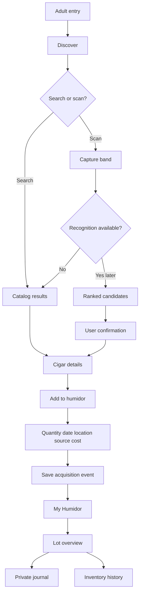
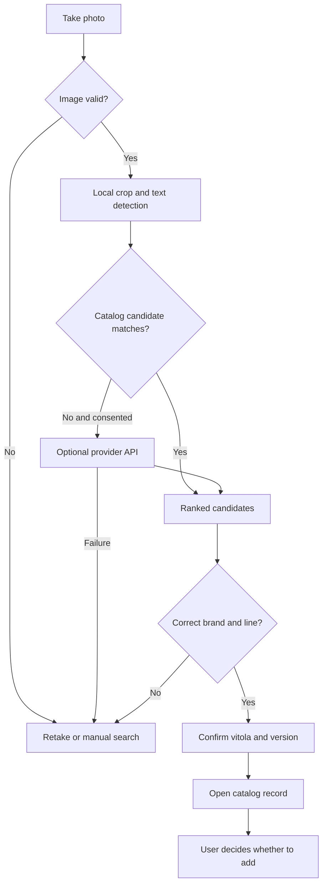
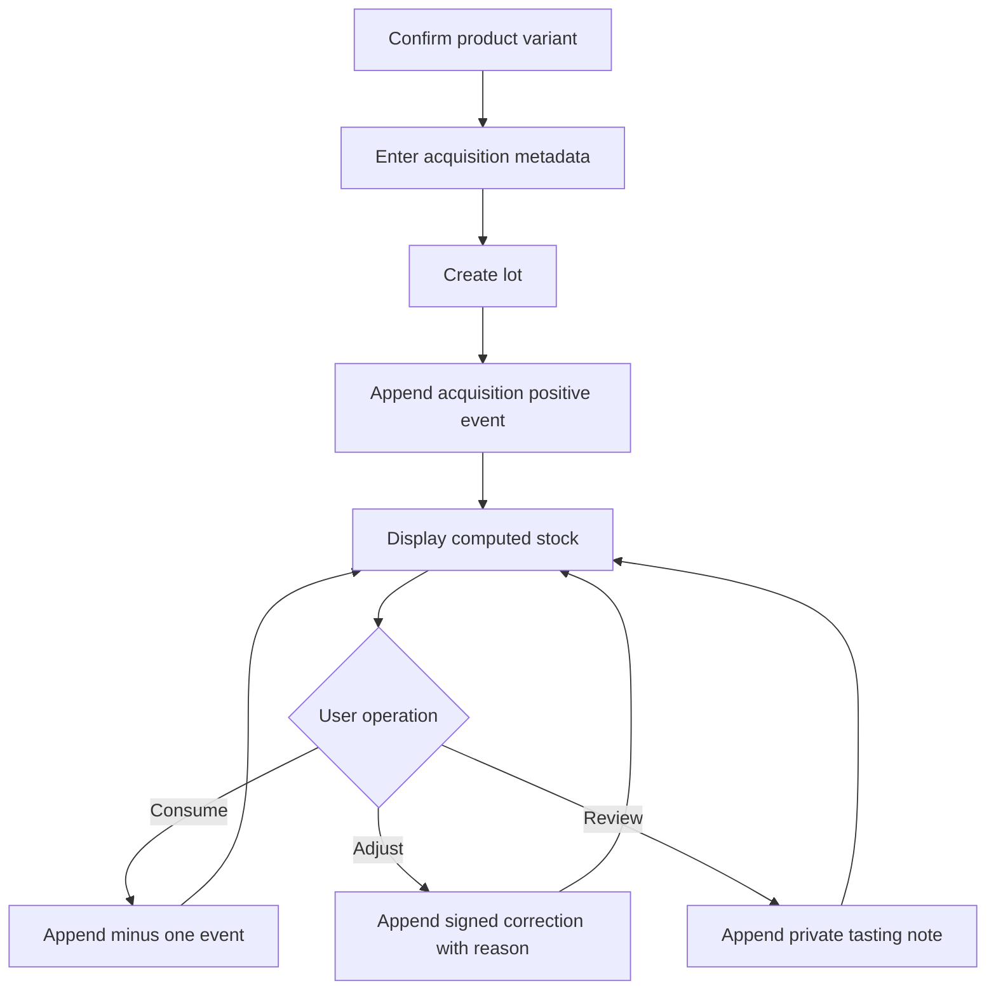
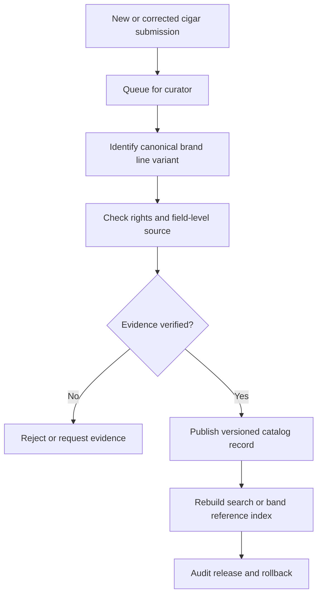
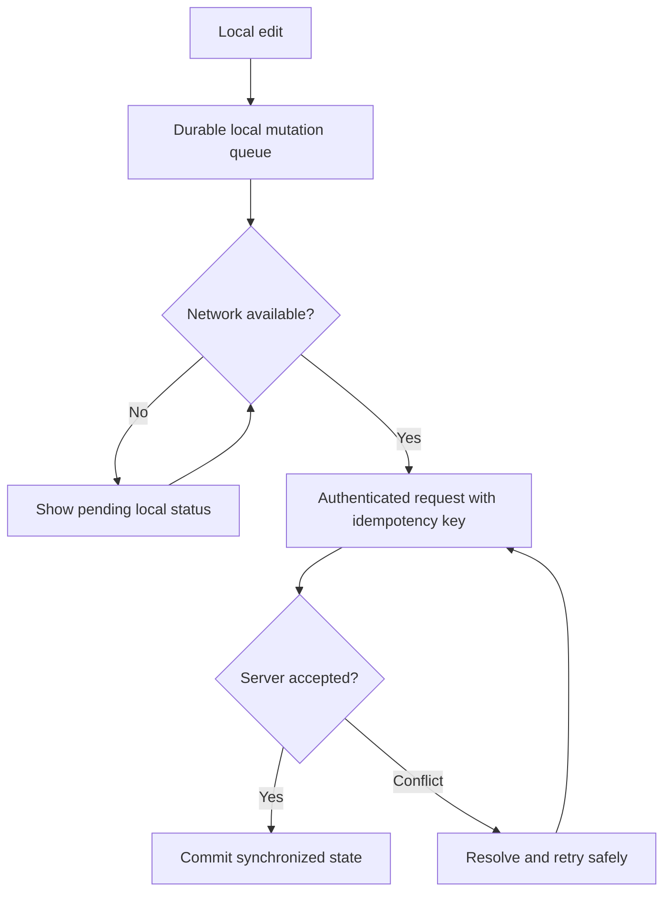

# Cigario user, inventory, scanner and administration flows

These graphs are implementation maps, not claims of completed production features. The local prototype currently implements manual catalog lookup, detail, new lot, humidor, event-based count and journal entries.

## Main journey

## Scanner confidence / failure states

## Provenance and stock ledger

## Catalog curator

## Offline sync (future)

